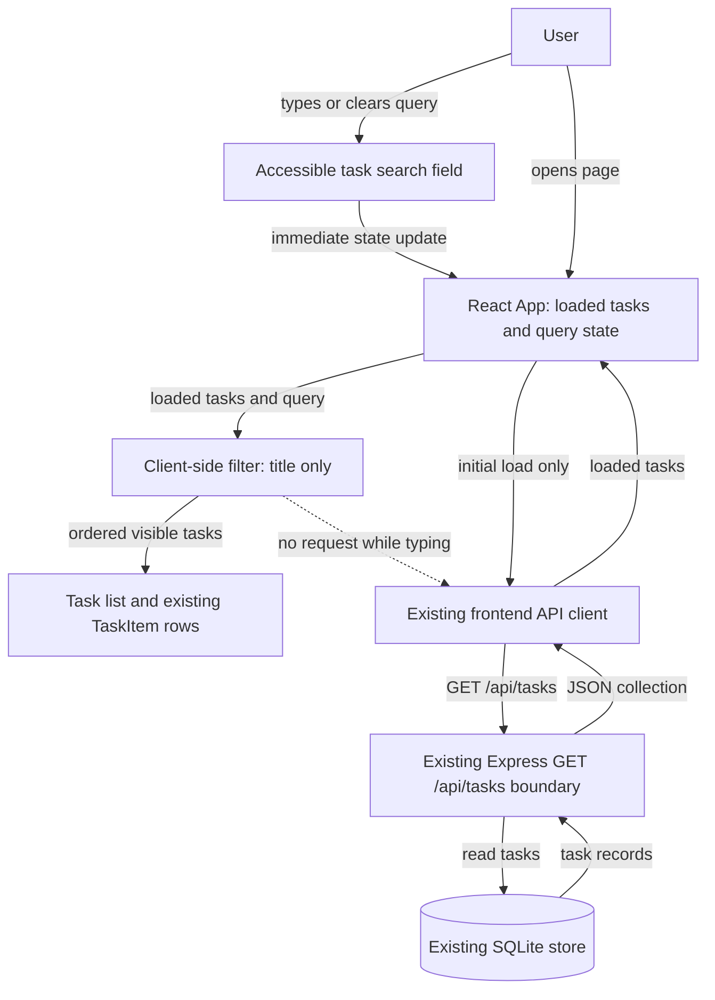

# Task Manager Auto-Search Architecture

## Purpose and scope

Add immediate, client-side search to the existing Task Manager page. Search filters only loaded task titles, preserves source order, and does not change task records or issue a request. The React page remains the owner of the source task collection and search text; the visible list is derived from those values.

The feature adds no backend or database behavior, API route, or third-party dependency. It does not add search by fields other than title.

## Requirements summary

- **Functional:** Provide an accessible search field; filter on each input change with case-insensitive substring matching against title; show no rows for zero matches and no separate no-results message; clearing restores the full loaded list; do not mutate tasks or make search requests.
- **Non-functional:** Updates appear immediate without debounce or a server round trip, retain source order, and retain the original loaded tasks.
- **Assumptions:** Search is performed on the loaded set; query whitespace is significant and is not trimmed; descriptions are outside scope because the current data contract has no description field. No specific response-time threshold or accessibility standard was supplied.
- **Out of scope:** Server, database, or API search; loading additional tasks; mutation or sorting of task data; description storage or matching; and matching any other task fields.
- **Acceptance coverage:** Typing filters by title, matching ignores case, no matches result in no task rows and no no-results message, and clearing restores all loaded tasks in order without an additional request.

### Agreed description-field decision

The stakeholder selected title-only search. The SQLite table contains only `id`, `title`, and `status`; `GET /api/tasks` returns those fields; and create/update routes do not provide a description. Rather than expanding the API or schema beyond the requested scope, the architecture and requirements treat title-only matching as the final contract. Description matching is explicitly out of scope.

## Architecture analysis

The application is a React 18 single-page frontend built with Vite, served in development at port 5173. Vite proxies `/api` requests to the existing Express 4 backend at port 4000. Express accesses the SQLite task store through `better-sqlite3`. The frontend API module centralizes fetch operations; the page currently loads tasks into React state and renders them in the existing task list.

Client-side filtering is the appropriate boundary because the scope limits search to currently loaded tasks and prohibits search API calls. Keep backend routes, database schema, API client, and installed packages unchanged.

## Components and responsibilities

| Component and file path | Status | Purpose and responsibilities | Interactions |
|---|---|---|---|
| Task Manager page — `Task_Manager_App/frontend/src/App.jsx` | Existing, affected | Owns loaded tasks and search query state; derives the visible tasks without mutating the source array; renders the search control, list, and existing empty/error UI. | Calls the existing API client for initial load and mutations; passes visible tasks to task rows. |
| Search field — within `Task_Manager_App/frontend/src/App.jsx` | New UI | Provides an accessible label identifying it as task search; updates query state on every change. | Updates page state only; no submit handler or API call. |
| Client-side filter — within `Task_Manager_App/frontend/src/App.jsx` | New behavior | Matches case-insensitive substrings in title; handles empty query, missing fields, and source-order retention. | Reads loaded tasks and query; returns a derived array to the list renderer. |
| Task row (`TaskItem`) — within `Task_Manager_App/frontend/src/App.jsx` | Existing, unchanged | Displays task title/status and existing edit/delete controls. | Rendered only for tasks in the derived visible list. |
| Frontend API client — `Task_Manager_App/frontend/src/api.js` | Existing, unchanged | Implements current GET and mutation requests and surfaces API errors. | Called for the initial task load and existing mutations; no search function is added. |
| Tasks API — `Task_Manager_App/backend/src/server.js` | Existing, unchanged | Serves the current task collection and existing create, update, and delete routes. | Reads/writes through the database module; has no search interaction. |
| SQLite store — `Task_Manager_App/backend/src/db.js` | Existing, unchanged | Stores current `id`, `title`, and `status` fields. | Used by the API; currently has no description column. |
| Frontend styles — `Task_Manager_App/frontend/src/styles.css` | Existing, potentially affected for presentation | Supplies presentation for the search field using existing page styles. | Styles the React-rendered page; no search behavior. |

## Technology choices

| Area | Choice | Rationale |
|---|---|---|
| Frontend | Existing React 18 state and render model | Keep search state with the page's loaded tasks and derive the filtered list locally; no state library or new component framework is needed. |
| Backend | Existing Express API, unchanged | The requirement is limited to already-loaded data and explicitly excludes API search. |
| Database | Existing SQLite store, unchanged | Filtering is in-memory and must not modify or query persisted data. |
| Testing | Existing Playwright/Playwright-BDD scripts for browser acceptance; existing Node `node:test` integration tests for backend regression | The root package defines `test:bdd` and depends on Playwright/Playwright-BDD; backend package uses Node's built-in test runner. Browser coverage can verify immediate filtering, ordering, clearing, and absence of search requests. |
| Build tools | Existing Vite and npm scripts | The existing Vite build validates the frontend without introducing build tooling. |

No packages are proposed. The existing dependencies remain React/React DOM and Vite on the frontend; Express, `better-sqlite3`, and CORS on the backend; and Playwright/Playwright-BDD in the app's root test tooling.

## End-to-end data flow

1. On page initialization, the existing `App` calls `getTasks()` through `frontend/src/api.js`, issuing the existing `GET /api/tasks`.
2. The API reads tasks from SQLite and returns the loaded collection in its existing order. The page stores it as source state.
3. The user types or clears the accessible search field. Each change updates query state immediately; no submit action or debounce is involved.
4. The page derives visible tasks by checking each loaded task's title for the query as a case-insensitive substring. It does not trim the query. An empty query yields the complete source collection.
5. The existing task list renders the derived tasks, retaining their original relative order. No matches produce no task rows and no search-specific no-results message.
6. Clearing the field restores the current source collection. Existing add/edit/delete flows continue to reload tasks through their existing API calls, after which the current search query filters the refreshed collection.

Typing, changing, or clearing the query causes **zero additional API calls**. The initial fetch and existing mutation workflows retain their current API behavior.

## State and error handling

| Scenario | Expected handling |
|---|---|
| Positive / happy path | A non-empty query matches title without regard to case. Results appear immediately and preserve the loaded order. |
| Missing/null task fields | Treat missing, `null`, or non-string title values as empty searchable text so filtering does not throw. |
| Malformed task payload | Do not pass an invalid top-level payload to list rendering; surface the invalid response through the page's existing error path. Ignore malformed individual records when deriving renderable rows. The current `getTasks`/`load` code does not validate the top-level response, so this is a robustness requirement for the feature's integration rather than current behavior. |
| Failed initial `GET /api/tasks` | Preserve the existing request-error display; do not fabricate results or issue a search request. The currently rendered empty-list message may appear as well because loading/error/empty states are not distinguished today. |
| Blank query | Return every task in source order. A string containing spaces is not blank after trimming because query text is not trimmed; it is matched literally. |
| No matches | Render zero task rows and no separate no-results message. Keep the existing “No tasks yet.” message tied to an actually empty loaded collection, not an empty filtered result. |

## Security and dependency safety

- Render the query and task content as normal React text; do not use `dangerouslySetInnerHTML`. React's normal text rendering escapes displayed content.
- Search input remains client-side state. It is not interpolated into SQL or sent to the backend.
- Preserve the specified query exactly except for case normalization used during comparison; do not trim it.
- Add no dependencies, API surface, or database query, so the feature introduces no new package vulnerability or supply-chain exposure.

## Component diagram

